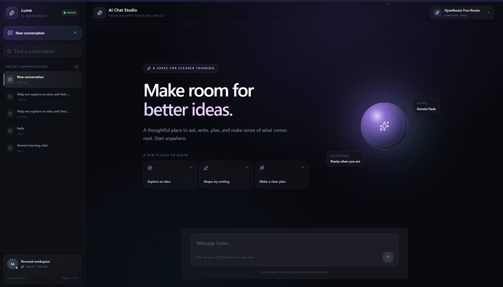
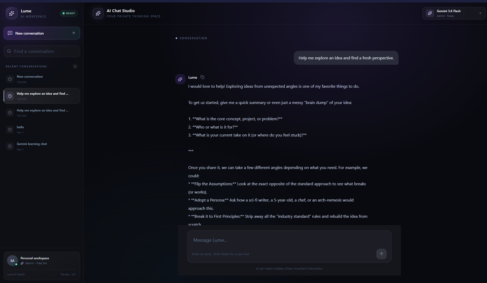
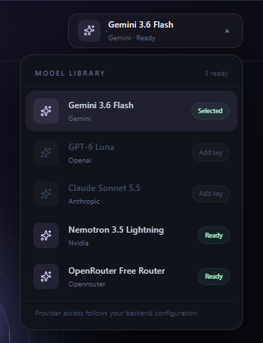
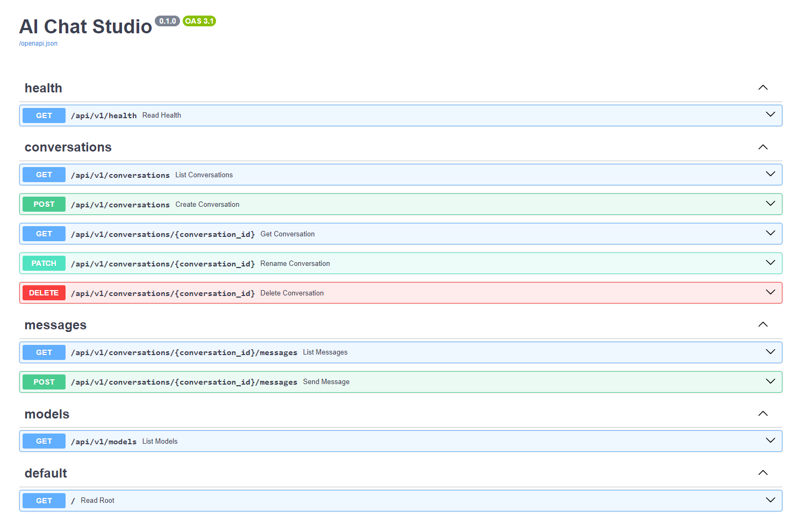

# Lume — AI Chat Studio

Lume is a full-stack AI chat application with a React interface and a FastAPI backend. It supports persistent conversations, message history, and supports conversations with Gemini, OpenAI, Anthropic Claude, NVIDIA NIM, and OpenRouter.

## Demo

[](https://www.youtube.com/watch?v=LC9ZVu1v9Ko)

*See Lume’s model selection and chat flow.*

## Screenshots

### Chat workspace


### Chat workspace




### Model selection



### API documentation



## Features

- Create, search, rename, and delete conversations
- Choose a configured AI model; unavailable providers are shown as not configured.
- Persist conversations and messages in SQLite
- View and restore conversation history
- Explore the API through FastAPI's OpenAPI documentation

## Technology

- **Frontend:** React, TypeScript, Vite, Tailwind CSS
- **Backend:** Python, FastAPI, Pydantic
- **Database:** SQLite, SQLAlchemy, Alembic
- **AI provider:** Google Gemini through the Google Gen AI SDK, OpenAI, Anthropic Claude, NVIDIA NIM, and OpenRouter.

## Project structure

```text
AIChatBot/
├── backend/
│   ├── alembic/                 # Database migrations
│   ├── app/
│   │   ├── api/v1/              # HTTP routes
│   │   ├── core/                # Application configuration
│   │   ├── db/                  # Database engine and models
│   │   ├── providers/           # Gemini integration
│   │   ├── repositories/        # Database access
│   │   ├── schemas/             # Request and response schemas
│   │   └── services/            # Application workflows
│   ├── data/                    # Local SQLite database
│   ├── .env.example
│   └── requirements.txt
|
├── docs/
│   └── assets/
│       └── screenshots/
│           ├── chat-workspace.png
│           ├── model-selection.png
│           └── api-docs.png
|
├── frontend/
│   └── src/features/            # Chat interface and API client
├── ARCHITECTURE.md
└── PROJECT_BRIEF.md
```

## Run locally

### Backend

In PowerShell, from the repository root:

```powershell
Set-Location .\backend
python -m venv .venv
.\.venv\Scripts\Activate.ps1
python -m pip install -r requirements.txt
Copy-Item .env.example .env
```

Open `backend\.env` and set your Gemini API key. Keep this file private; it is ignored by Git.

Apply the database migrations and start the API:

```powershell
alembic upgrade head
python -m uvicorn app.main:app --reload --port 8001
```

API documentation: [http://127.0.0.1:8001/docs](http://127.0.0.1:8001/docs)

### Frontend

In a second PowerShell terminal:

```powershell
Set-Location .\frontend
npm ci
npm run dev
```

Open the local URL printed by Vite. The backend's `CORS_ORIGINS` setting must include that frontend origin.

To create a production frontend build:

```powershell
npm run build
```

## API routes

- `GET /api/v1/health`
- `GET /api/v1/conversations`
- `POST /api/v1/conversations`
- `GET /api/v1/conversations/{conversation_id}`
- `PATCH /api/v1/conversations/{conversation_id}`
- `DELETE /api/v1/conversations/{conversation_id}`
- `GET /api/v1/conversations/{conversation_id}/messages`
- `POST /api/v1/conversations/{conversation_id}/messages`
- `GET /api/v1/models`

## Configuration

Backend configuration lives in `backend/.env`. Use `backend/.env.example` as the template. Never commit API keys or other secrets. API usage may have provider-specific pricing, quotas, and terms.

The SQLite database is local development data and is excluded from Git.